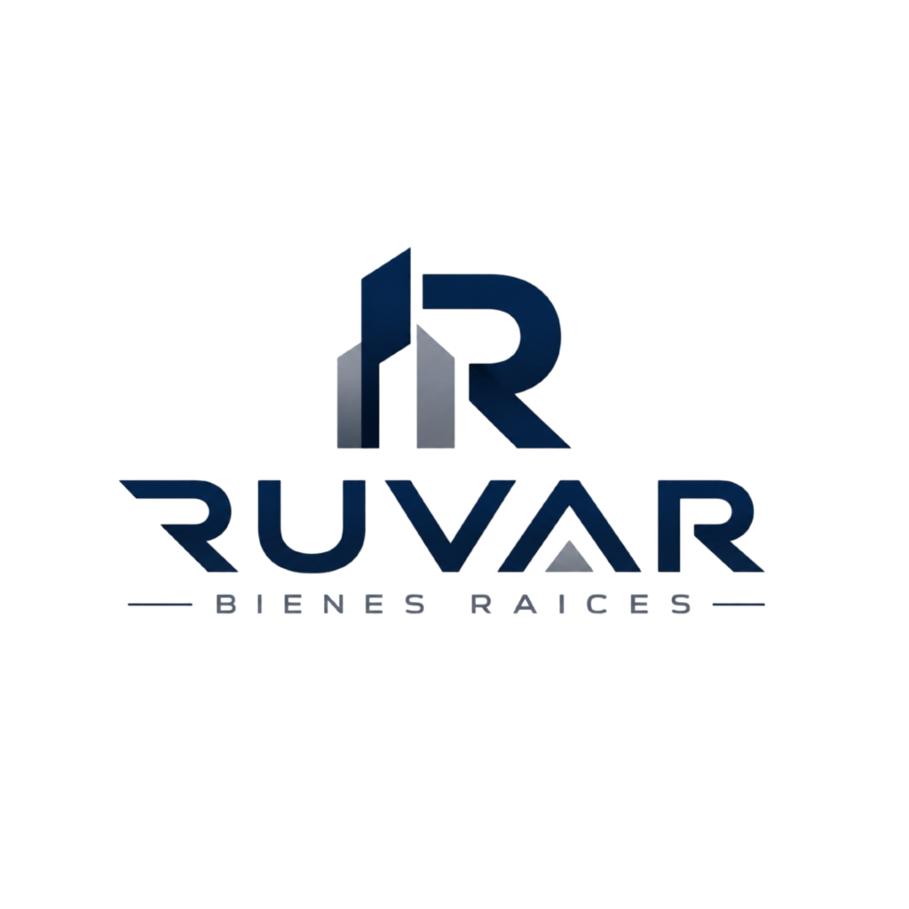

# Ruvar Bienes Raíces — Plataforma de Gestión Inmobiliaria

<p align="center">
  
</p>

<p align="center">
  <strong>Sistema integral de administración inmobiliaria de lujo desarrollado con Laravel 12, React 19, Inertia.js y Tailwind CSS v4.</strong>
</p>

<p align="center">
  
  
  
  
  
</p>

---

## 🏛️ Acerca del Proyecto

**Ruvar Bienes Raíces** es una plataforma administrativa diseñada bajo los más altos estándares visuales y de rendimiento para la gestión de bienes raíces premium. La arquitectura combina la robustez y seguridad del ecosistema **Laravel 12** con la reactividad y dinamismo de **Inertia.js con React 19**, estilizado con una paleta sobria y elegante en tonalidades azul marino (`#0b1a30` / `#070e1c`) y modo oscuro nativo.

---

## ✨ Características Principales

### 📊 1. Panel de Resumen Ejecutivo
- Indicadores clave de rendimiento (KPIs):
  - **Cantidad de Propiedades:** Métricas de inmuebles en venta y alquiler.
  - **Comentarios en Propiedades:** Consultas y retroalimentación de clientes.
  - **Artículos Publicados:** Novedades y análisis del mercado inmobiliario.
- Encabezado depurado con selector de usuario rápido y acceso directo al perfil.

### 👥 2. Gestión Integral de Usuarios (`/usuarios`)
- Tabla interactiva con búsqueda en tiempo real por nombre, correo o rol.
- Filtro dropdown por rol asignado.
- Panel lateral (*Sheet*) amplio de dos columnas para creación y edición de usuarios.
- Validación en tiempo real con confirmación de contraseña requerida.
- Protección de seguridad: bloqueo absoluto de auto-eliminación para la cuenta en sesión.

### 🛡️ 3. Matriz de Roles y Permisos por Módulo (`/roles`)
- **Matriz de Privilegios:** Asignación granular de permisos por módulo (`Propiedades`, `Proyectos`, `Artículos`, `Lista de Usuarios`, `Roles de Usuarios`).
- **Conmutadores Inteligentes (*Switches*):** Control independiente para **Ver** y **Gestionar** con persistencia inmediata y auto-guardado en segundo plano.
- **Colores Distintivos Configurables:** Cada perfil de rol cuenta con su propio color configurado mediante paleta de 10 colores de lujo o selector hexadecimal personalizado.
- **RoleBadge Dinámico:** Los distintivos de color se reflejan en tiempo real en la tabla de usuarios, selectores y tarjetas informativas.

### 🔔 4. Sistema de Notificaciones Sonner
- Notificaciones toast centradas en la parte superior (`top-center`).
- Botón de cierre descartable (*dismissable*) con microinteracciones y estilo de marca.
- Tipología de notificaciones:
  - **Éxito (Success):** Creación/edición de registros y guardado de permisos.
  - **Información (Info):** Cierre de sesión y cambios de apariencia.
  - **Error:** Intentos de auto-eliminación o violaciones de reglas de negocio.
- Detección automática de mensajes de sesión (*flash messages*) de Laravel a través de Inertia.

### 🌐 5. Experiencia y Localización
- Localización completa al español en todas las vistas de administración, perfil, seguridad y apariencia.
- Soporte para autenticación por contraseña, autenticación de dos factores (2FA) y llaves de acceso (*Passkeys*).
- Registro público deshabilitado para garantizar un entorno puramente administrativo y privado.

---

## 🛠️ Stack Tecnológico

| Capa | Tecnologías |
| :--- | :--- |
| **Backend** | [Laravel 12](https://laravel.com), [PHP 8.3+](https://www.php.net), [Laravel Fortify](https://laravel.com/docs/fortify) |
| **Frontend** | [React 19](https://react.dev), [TypeScript](https://www.typescriptlang.org), [Inertia.js v2](https://inertiajs.com) |
| **Estilos** | [Tailwind CSS v4](https://tailwindcss.com), [Lucide React](https://lucide.dev) |
| **Componentes UI** | [Radix UI](https://www.radix-ui.com), [shadcn/ui](https://ui.shadcn.com), [Sonner](https://sonner.emilkowal.ski) |
| **Herramientas** | [Vite](https://vitejs.dev), [Wayfinder](https://github.com/laravel/wayfinder), [Laravel Pint](https://laravel.com/docs/pint), [PHPUnit](https://phpunit.de) |

---

## 🚀 Instalación y Puesta en Marcha

### Prerrequisitos
- PHP >= 8.3 con extensiones requeridas por Laravel (pdo_mysql, mbstring, openssl, tokenizer, xml, ctype, json, bcmath).
- Composer 2.x
- Node.js >= 20.x y npm
- MySQL / MariaDB (puerto 3307 por defecto para este entorno)

### Pasos de Instalación

1. **Clonar el repositorio:**
   ```bash
   git clone https://github.com/lerichardv/ruvar-bienes-raices-platform.git
   cd ruvar-bienes-raices-platform
   ```

2. **Instalar dependencias de PHP y JavaScript:**
   ```bash
   composer install
   npm install
   ```

3. **Configurar el entorno:**
   ```bash
   cp .env.example .env
   php artisan key:generate
   ```

4. **Configurar la base de datos en `.env`:**
   ```env
   DB_CONNECTION=mysql
   DB_HOST=127.0.0.1
   DB_PORT=3307
   DB_DATABASE=ruvar-bienes-raices
   DB_USERNAME=root
   DB_PASSWORD=
   ```

5. **Ejecutar migraciones y seeders:**
   ```bash
   php artisan migrate --seed
   ```

6. **Compilar recursos de frontend:**
   ```bash
   # Para desarrollo
   npm run dev

   # Para producción
   npm run build
   ```

7. **Iniciar el servidor local:**
   ```bash
   php artisan serve
   ```

---

## 🔐 Credenciales de Acceso Inicial

El seeder del sistema genera automáticamente el usuario Administrador Principal:

- **Correo electrónico:** `ricardo.valladares.triminio@gmail.com`
- **Contraseña:** `12345678`
- **Rol:** `Administrador` (Control integral de todos los módulos del sistema)

---

## 🧪 Pruebas y Calidad de Código

```bash
# Ejecutar suite de pruebas PHPUnit
php artisan test --compact

# Formateo de código PHP bajo estándares Laravel Pint
vendor/bin/pint --format agent

# Verificación de compilación de frontend
npm run build
```

---

## 📄 Licencia

Este proyecto es software privado y confidencial desarrollado exclusivamente para **Ruvar Bienes Raíces**. Todos los derechos reservados.
